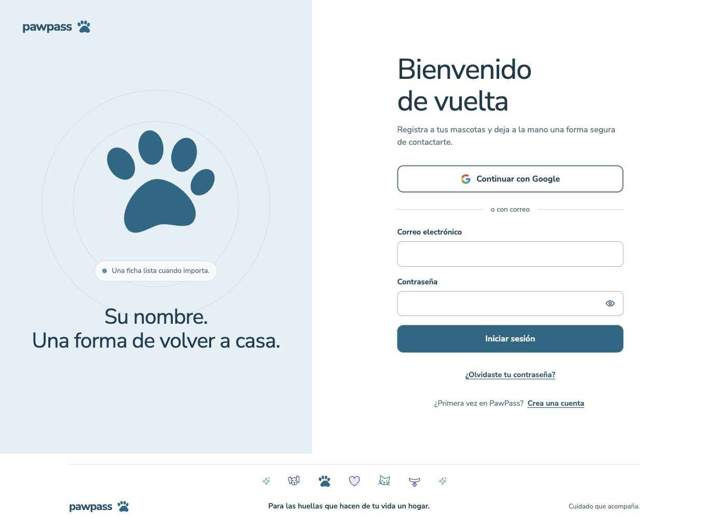
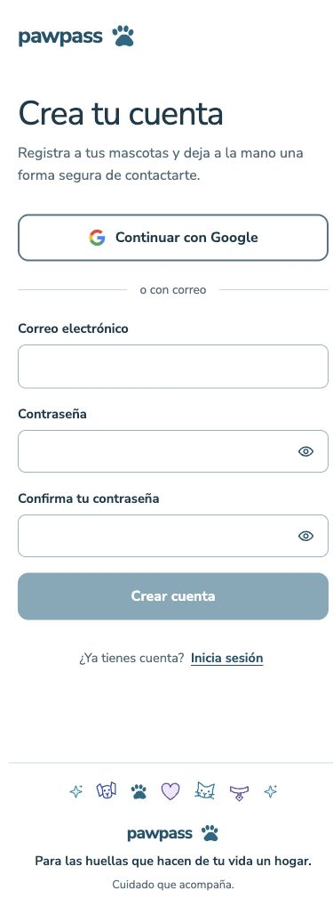

# Refactor visual · fase 1: base visual y CSS

## Alcance y criterio de aceptación

Mantener los flujos y la apariencia efectiva del cierre de V1, estableciendo tokens reutilizables y reduciendo las reglas compartidas duplicadas. No incluye aplicar componentes a todas las páginas (fase 2), portada pública ni `/acceso` (fase 3), datos, latencia o migraciones.

Se conservan la referencia azul-rescate-06 y las decisiones posteriores de DESIGN.md: Nunito Sans, fotografías completas, azul mineral para acciones habituales y WhatsApp, y jerarquía sólido / contorno / texto. La validación de contraseña conserva su excepción verde localizada. No se agregan nuevos colores de interfaz.

## Organización

- `src/features/brand/tokens.css`: única definición de tokens globales de color, estados, tipografía, espacio, radios, acciones y movimiento. Los nombres existentes siguen funcionando. `@theme inline` expone utilidades Tailwind v4 (`bg-brand`, `text-muted`, `font-sans`, etc.) sin obligar a migrar consumidores.
- `src/features/brand/actions.css`: primitivas CSS reutilizadas por botones, enlaces y summary nativos. Consolida las variantes existentes y sus estados; no introduce un componente polimórfico ni cambia la semántica.
- `src/features/brand/status-badge.css`: consume colores semánticos compartidos sin modificar sus símbolos o etiquetas.
- `src/features/auth/auth.css`: acceso, composición responsive y contraseña; la excepción de validación permanece en este módulo.
- `src/features/health-record/health-record.css`: estilos del carnet con un único panel base y un override móvil; conserva las especializaciones de registros y documentos.
- `src/app/globals.css`: importaciones centralizadas y estilos heredados pendientes. Mantener su orden explícito: Tailwind, tokens, acciones, acceso, carnet y reglas restantes. Las clases de los módulos extraídos mantienen sus nombres globales en esta etapa para evitar una migración de markup propia de fase 2.

No se extraen tarjetas heterogéneas ni componentes React sin necesidad. Los iconos y estados ya compartidos se conservan. Los estilos complejos del cartel permanecen en su módulo.

## Medición reproducible

Build de producción con `npm run build` (Next 16.4.3, webpack), antes en `8fb2adb` y después con las mismas dependencias y entorno. Suma de todos los `.next/static/css/*.css`; gzip individual por archivo con `node:zlib.gzipSync`, configuración predeterminada.

| Medida | Antes | Después |
| --- | ---: | ---: |
| Líneas de globals.css | 1010 | 790 |
| Archivos CSS compilados | 11 | 11 |
| Bytes CSS compilados | 90132 | 90828 |
| Bytes gzip (suma individual) | 21294 | 21456 |

El global se reduce 21,8 %. El total compilado aumenta 696 bytes (0,77 %), o 162 bytes gzip (0,76 %): los tokens compartidos tienen un pequeño coste. Esta fase mejora mantenimiento; no acredita reducción de descarga. La suma incluye fuentes y fragmentos de todas las rutas, no representa una visita, no mide caché, Brotli, red, latencia ni datos. Mover reglas a archivos importados globalmente no equivale a cargar menos CSS por ruta.

## Validación y límites

- `npm test`: 16 archivos, 96 pruebas aprobadas. Se reutiliza la cobertura de comportamiento; no se añaden pruebas que inspeccionen texto CSS o dupliquen la implementación para este refactor visual reversible.
- `npm run lint`, `npm run typecheck`, `npm run build`: aprobados.
- Navegador local en desarrollo y producción: acceso y registro a 1366 × 900 y 390 × 844; también comparación móvil inicial a 346px. Sin desbordamiento horizontal en los estados inspeccionados.
- Botones principales mantienen 52,8px de altura efectiva y radio 12px; campos de contraseña 48px, etiquetas accesibles, registro deshabilitado sin requisitos y foco de teclado azul de 3px con offset 3px.
- Se conserva reduced-motion y forced-colors en CSS. La comprobación básica no certifica WCAG 2.2 AA completa ni sustituye pruebas con lector de pantalla.
- No se autentica ni se modifican datos. El carnet privado no tiene una revisión visual con registros reales en esta fase; se revisó la cascada de reglas extraídas y la cobertura de dominio existente.
- Detector Impeccable ejecutado: avisos de colores, tamaños y radios heredados fuera de la escala documentada. Quedan para la fase de aplicación a páginas, sin convertirlos en nuevas reglas. El sidecar `.impeccable/design.json` está desactualizado respecto de DESIGN.md; no se regeneró como efecto secundario.

Capturas de producción sin datos personales:

