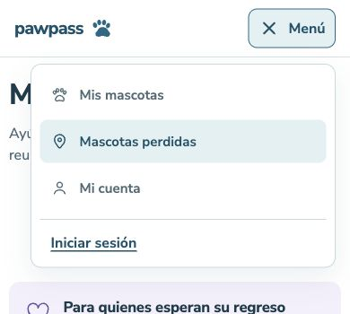

# Refactor visual · fase 1: base visual y CSS

## Alcance y criterio de aceptación

Mantener los flujos y la apariencia efectiva del cierre de V1, estableciendo tokens reutilizables y reduciendo las reglas compartidas duplicadas. No incluye aplicar componentes a todas las páginas (fase 2), portada pública ni `/acceso` (fase 3), datos, latencia o migraciones.

Se conservan la referencia azul-rescate-06 y las decisiones posteriores de DESIGN.md: Nunito Sans, fotografías completas, azul mineral para acciones habituales y WhatsApp, y jerarquía sólido / contorno / texto. La validación de contraseña conserva su excepción verde localizada. No se agregan nuevos colores de interfaz.

## Organización

- `src/features/brand/tokens.css`: única definición de tokens globales de color, estados, tipografía, espacio, radios, acciones y movimiento. Los nombres existentes siguen funcionando. `@theme inline` expone utilidades Tailwind v4 (`bg-brand`, `text-muted`, `font-sans`, etc.) sin obligar a migrar consumidores.
- `src/features/brand/actions.css`: primitivas CSS reutilizadas por botones, enlaces y summary nativos. Consolida las variantes existentes y sus estados; no introduce un componente polimórfico ni cambia la semántica.
- `src/components/ui/button.tsx`: botón nativo compartido, variantes tipadas y ancho completo; por defecto no envía formularios. Los envíos declaran `type="submit"`. Reutilizado en acceso, perfil, mascotas, cuidados, carnet, recuperación, QR y cartel. Los enlaces y summary mantienen su semántica propia.
- `src/components/ui/form-message.tsx`: mensajes vacíos no renderizan; resultados usan status/polite y errores inmediatos pueden usar alert. Reutilizado en formularios de varios módulos.
- `src/features/brand/brand.css`: identidad, motivos, pie global y página no encontrada.
- `src/features/navigation/navigation.css`: cabecera, menú y carga, con una sola definición actual del menú; elimina la cascada de la antigua navegación inferior.
- `src/features/brand/status-badge.css`: consume colores semánticos compartidos sin modificar sus símbolos o etiquetas.
- `src/features/auth/auth.css`: acceso, composición responsive y contraseña; la excepción de validación permanece en este módulo.
- `src/features/health-record/health-record.css`: estilos del carnet con un único panel base y un override móvil; conserva las especializaciones de registros y documentos.
- `src/app/globals.css`: importaciones centralizadas y estilos heredados pendientes. Mantener su orden explícito: Tailwind, tokens, acciones, acceso, carnet, marca, navegación y reglas restantes. Las clases de los módulos extraídos mantienen sus nombres globales en esta etapa sin convertir toda la interfaz a CSS Modules.

Se eliminan selectores sin consumidores (filas, QR y editor anteriores) y declaraciones reemplazadas por la misma propiedad en el mismo selector y condición. Se preservan clases dinámicas de motivos y severidad. No se extraen tarjetas heterogéneas. Los iconos y estados ya compartidos se conservan. Los estilos complejos del cartel permanecen en su módulo.

## Medición reproducible

Build de producción con `npm run build` (Next 16.4.3, webpack), antes en `8fb2adb` y después con las mismas dependencias y entorno. Suma de todos los `.next/static/css/*.css`; gzip individual por archivo con `node:zlib.gzipSync`, configuración predeterminada.

| Medida | Base main | Primera extracción | Final |
| --- | ---: | ---: | ---: |
| Líneas de globals.css | 1010 | 790 | 516 |
| Archivos CSS compilados | 11 | 11 | 11 |
| Bytes CSS compilados | 90132 | 90828 | 78041 |
| Bytes gzip (suma individual) | 21294 | 21456 | 19201 |

El global se reduce 48,9 % frente a main. El compilado se reduce 13,4 % (12091 bytes) y gzip 9,8 % (2093 bytes) frente a main. Respecto de la primera extracción del PR, la limpieza adicional reduce CSS 14,1 % y gzip 10,5 %. La reducción de bytes proviene de retirar reglas, no de repartirlas entre archivos. La suma incluye fuentes y fragmentos de todas las rutas, no representa una visita, no mide caché, Brotli, red, latencia ni datos. Mover reglas a archivos importados globalmente no equivale a cargar menos CSS por ruta.

## Validación y límites

- `npm test`: 17 archivos, 99 pruebas aprobadas. Tres pruebas nuevas de primitivas se observaron fallar antes de completar la implementación: tipo seguro del botón, ausencia de anuncio vacío y distinción status/alert. No se añaden pruebas que inspeccionen texto CSS.
- `npm run lint`, `npm run typecheck`, `npm run build`: aprobados.
- Navegador local en desarrollo y producción: acceso y registro a 1366 × 900 y 390 × 844; también comparación móvil inicial a 346px. Sin desbordamiento horizontal en los estados inspeccionados.
- Botones principales mantienen 52,8px de altura efectiva y radio 12px; campos de contraseña 48px, etiquetas accesibles, registro deshabilitado sin requisitos y foco de teclado azul de 3px con offset 3px.
- Menú público revisado en producción a 1366px y 390px: dentro del viewport, enlaces de 48px, estado activo y cierre con Escape que devuelve el foco al botón. Sin autenticación ni envío de formularios.
- Se conserva reduced-motion y forced-colors en CSS. La comprobación básica no certifica WCAG 2.2 AA completa ni sustituye pruebas con lector de pantalla.
- No se autentica ni se modifican datos. El carnet privado no tiene una revisión visual con registros reales en esta fase; se revisó la cascada de reglas extraídas y la cobertura de dominio existente.
- Detector Impeccable ejecutado: avisos de colores, tamaños y radios heredados fuera de la escala documentada. Quedan para la fase de aplicación a páginas, sin convertirlos en nuevas reglas. El sidecar `.impeccable/design.json` está desactualizado respecto de DESIGN.md; no se regeneró como efecto secundario.

Capturas de producción sin datos personales:

