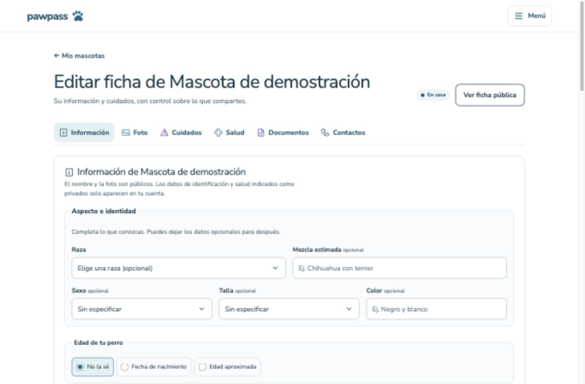

# Refactor visual · fase 2: páginas existentes

## Alcance

Las páginas existentes adoptan `PageFrame` y `PageContent`: Mis mascotas, editor, Mi cuenta, carnet, pérdida privada, tablón, ficha pública de pérdida y QR. Los encabezados de las páginas privadas y del tablón usan `PageHeading`; cuidados usa `SectionHeading`. Los estados vacíos del carnet y del tablón comparten `EmptyState`, con títulos de nivel adecuado. `PetStatusBadge` reúne el estado en tarjeta, editor y gestión de pérdida. La huella de sustitución comparte un único SVG decorativo.

El carnet y las herramientas QR usan `FormMessage` para evitar anuncios vacíos y mantener el mismo tratamiento del resultado. La envoltura usa Tailwind v4 (`min-w-0`) y la composición compartida se encapsula en CSS Modules con los tokens aprobados. Se retiran selectores sustituidos y encabezados obsoletos de global, editor y carnet. Las tarjetas privada y pública conservan sus componentes independientes.

No hay cambios de consultas, acciones, dominio, esquema, permisos, metadatos o privacidad. Los cuatro formatos del cartel conservan su implementación. Portada pública, `/acceso`, datos y latencia quedan fuera.

## Medición

Comparación de producción desde `bc9f612` (merge de PR #9), con las mismas dependencias y entorno. `npm run build` usa Next 16.4.3 y webpack. Se suman todos los `.next/static/css/*.css`; gzip se calcula por archivo con `node:zlib.gzipSync` y se suma, como en fase 1.

| Medida | Antes | Después | Diferencia |
| --- | ---: | ---: | ---: |
| Líneas de globals.css | 516 | 460 | −56 (10,9 %) |
| Fragmentos CSS | 11 | 13 | +2 |
| Bytes CSS minificados | 78041 | 76339 | −1702 (2,2 %) |
| Bytes gzip por archivo, sumados | 19201 | 19467 | +266 (1,4 %) |

CSS Modules añade dos fragmentos y reduce la posibilidad de colisiones. La suma gzip incluye el coste independiente de cada fragmento; no equivale a transferencia por visita, caché, Brotli o latencia. Se informa el aumento gzip, aunque disminuyen el global y los bytes compilados.

## Verificación

- `npm test`: 18 archivos y 105 pruebas aprobadas. Se añadieron seis comprobaciones de estructura semántica, títulos accesibles, acción del estado vacío y decoración de la huella/estado. Se ejecutaron antes de disponer de las primitivas y después de implementarlas.
- `npm run lint`, `npm run typecheck` y `npm run build`: aprobados. La compilación detectó imports antes de `use client`; se corrigió su orden y la compilación posterior pasó.
- Navegador: escritorio 1366 × 900 y móvil 390 × 844. Mis mascotas, cuenta, carnet, editor y formulario de pérdida se inspeccionaron con componentes reales en una ruta temporal y datos ficticios. La ruta temporal se eliminó antes de entregar. No se enviaron formularios ni se modificaron datos.
- Tablón, ficha pública de pérdida y QR: rutas reales consultadas sin sesión y sin acciones. El ancho de documento no excedió el viewport en las superficies inspeccionadas. Las capturas incluidas solo contienen fixtures ficticios.
- Menú: abrir, Escape y devolución del foco al botón comprobados. Se conserva el foco global, reduced-motion y forced-colors. No es una certificación WCAG 2.2 AA ni una prueba formal con lector de pantalla.
- Impeccable: cero antipatrones; tres avisos tipográficos de escalas existentes (1,65rem, 1,3rem y 0,75rem). El sidecar de diseño no se regeneró.

La verificación de superficies privadas con fixtures cubre presentación y reflujo; no sustituye una sesión completa para validar integración SSR, autorizaciones, operaciones de datos, carga de documentos o exportación del cartel. Esas reglas no se modifican en este PR.

## Capturas con datos ficticios

