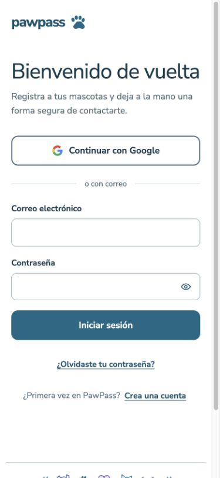
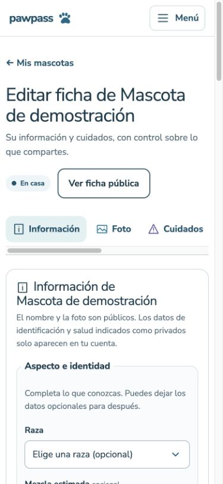
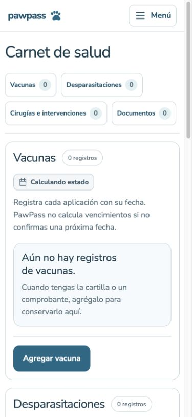

# Refactor visual · fase 2: páginas existentes

## Alcance

Mis mascotas, editor, Mi cuenta, carnet, pérdida privada, tablón, ficha pública de pérdida y QR adoptan la estructura común. `PageFrame`, `PageContent` y `PageHeading` componen las páginas; `SectionHeading` reúne el encabezado de cuidados. `EmptyState` da nombre accesible a los estados vacíos del carnet y del tablón. `PetStatusBadge` comparte el estado en tarjeta, editor y pérdida. La huella de sustitución usa un solo SVG decorativo. Las tarjetas privada y pública mantienen componentes independientes.

`FormGrid` y `FormActions` comparten rejillas responsive y agrupación de acciones en perfil, alta, detalles, cuidados, reporte y carnet. El carnet elimina su rejilla duplicada y consume la misma primitiva. `FormMessage` conserva resultados, anuncios y ausencia de mensajes vacíos. Los formularios conservan sus acciones, campos, validaciones y estados de envío.

## Dependencias de estilos y componentes

El layout raíz conserva Tailwind, tokens, acciones, marca y reglas básicas compartidas. Acceso, navegación, carga, formularios, carnet, listado, tarjeta, alta, editor, pérdida privada, recuperación, tablón, ficha pública y QR importan sus estilos desde sus consumidores. Las reglas de una composición especial permanecen con su feature. Las hojas que siempre pertenecen al mismo componente se reúnen en un archivo.

`RecoverPetForm` y `QuickRecovery` pasan a `recovery-forms.tsx` conservando sus implementaciones. Las tarjetas públicas ya no importan el formulario completo de publicación ni su conversión de fotografías para ofrecer la recuperación. En los chunks cliente observados del tablón no aparece `createImageBitmap` ni la conversión WebP del formulario de reporte.

No hay cambios de consultas, acciones de servidor, dominio, esquema, permisos, metadatos o privacidad. Los cuatro formatos del cartel conservan su implementación; solo se localizan los estilos del contenedor plegable. Portada pública, `/acceso`, datos y latencia quedan fuera.

## Medición global de producción

Mismas dependencias y entorno; `npm run build` usa Next 16.4.3 y webpack. Se suman todos los `.next/static/css/*.css`; gzip se calcula por archivo con `node:zlib.gzipSync` y se suma.

| Medida | PR #9 | Primera entrega fase 2 | Fase 2 completada |
| --- | ---: | ---: | ---: |
| Líneas de globals.css | 516 | 460 | 52 |
| Fragmentos CSS | 11 | 13 | 27 |
| Bytes CSS minificados | 78041 | 76339 | 77221 |
| Bytes gzip por archivo, sumados | 19201 | 19467 | 24878 |

La separación reduce el global 89,9 % frente a PR #9; el compilado total baja 820 bytes (1,1 %). El total gzip aumenta 5677 bytes (29,6 %) al comprimir más fragmentos independientes. Frente a la primera entrega, el compilado sube 882 bytes y gzip 5411 bytes. Se acepta ese coste para evitar distribuir hojas de otras capacidades en cada página; no se presenta como mejora de latencia.

## CSS por ruta

`node scripts/audit-route-assets.mjs`, después del build, obtiene los CSS emitidos para cada página y sus layouts/loading ascendentes. No suma entradas de páginas ajenas que también figuran en el manifiesto RSC. Comprueba presencia del estilo esperado y ausencia de acceso, carnet, cartel, editor, reporte, navegación y rescate en rutas ajenas.

| Ruta | Hojas | Bytes CSS | Gzip sumado |
| --- | ---: | ---: | ---: |
| `/` | 3 | 26379 | 7989 |
| `/auth/reset-password` | 3 | 26379 | 7989 |
| `/cuenta` | 6 | 27268 | 8634 |
| `/mascotas` | 10 | 34617 | 11261 |
| `/mascotas/[id]` | 13 | 39579 | 13032 |
| `/mascotas/[id]/carnet` | 10 | 38285 | 11904 |
| `/mascotas/[id]/perdida` | 10 | 33868 | 11162 |
| `/perdidas` | 8 | 31892 | 10099 |
| `/perdidas/[code]` | 10 | 34925 | 10977 |
| `/p/[code]` | 6 | 24040 | 7513 |

Resultado: cero estilos de capacidades inesperadas y cero estilos esperados ausentes. Las rutas privadas se auditan sin autenticación desde sus artefactos de compilación. En navegador de producción se confirmó además la carga de acceso, tablón, ficha pública y QR mediante las hojas enlazadas y sus reglas CSS. El QR no contiene estilos de acceso, carnet, menú ni reporte; el acceso no contiene menú ni carnet.

Estas cifras describen la entrada directa a cada ruta. Los estilos base y las primitivas compartidas incluyen estados interactivos y variantes; no se promete que cada selector se use en el primer viewport. Next puede conservar hojas ya visitadas durante navegación cliente, y puede agrupar dependencias compartidas. La medición no representa una sesión completa, caché, Brotli, red o latencia.

## Verificación y límites

- 18 archivos / 105 pruebas aprobadas; lint, typecheck, build y `git diff --check` aprobados. El nuevo control de recursos audita el resultado compilado y falla ante dependencias CSS inesperadas o ausentes.
- Producción: acceso, tablón, ficha pública de pérdida y QR en 1366 × 900 y 390 × 844. Sin desbordamiento horizontal; acceso conserva su composición.
- Desarrollo: componentes privados aislados en rutas temporales distintas, con fixtures ficticios. Mascotas, editor, cuenta, carnet y reporte sin desbordamiento a ambas anchuras; campos de texto/select conservan borde de 1px y altura aproximada de 49px. No se enviaron formularios ni se modificaron datos. Las rutas temporales se eliminaron.
- Se conserva la revisión previa de menú: Escape devuelve foco al botón. No es certificación WCAG 2.2 AA ni prueba formal con lector de pantalla.
- La revisión privada con fixtures no sustituye una sesión completa para validar SSR, autorización, operaciones de datos, documentos o exportación del cartel. Esas reglas no se modifican.
- El commit de localización de CSS supera la guía de 400 líneas: mueve conjuntamente las reglas y sus imports para conservar un grafo de dependencias completo en el mismo commit. La verificación y documentación se guardan aparte.

## Capturas seguras

