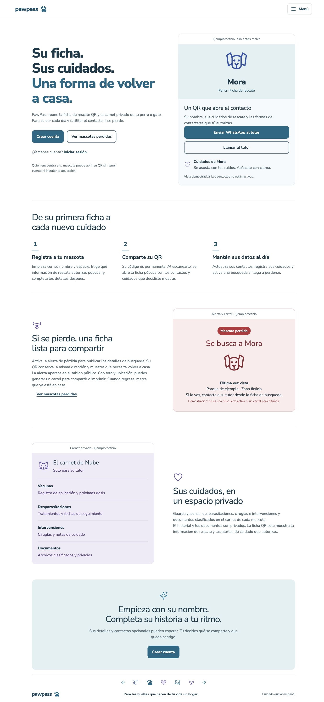
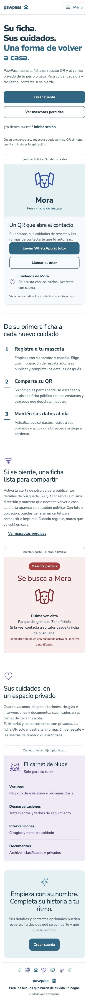
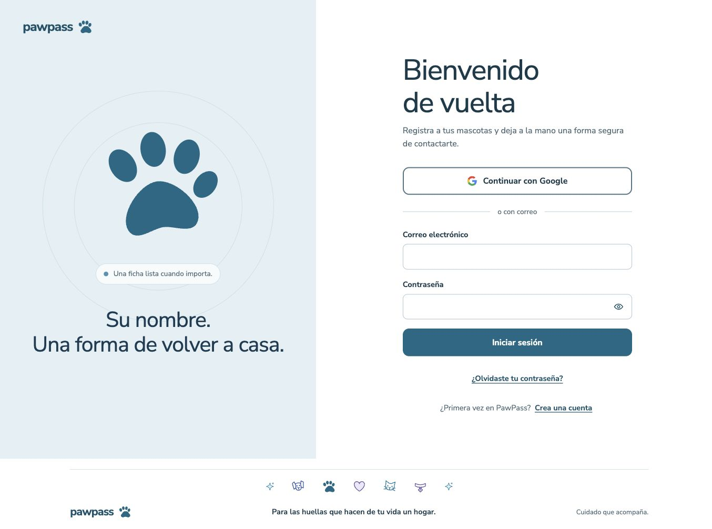
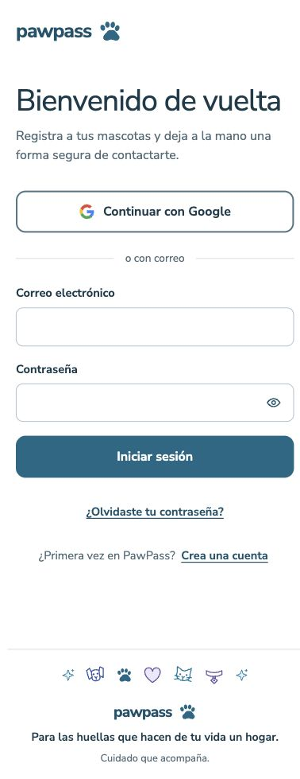
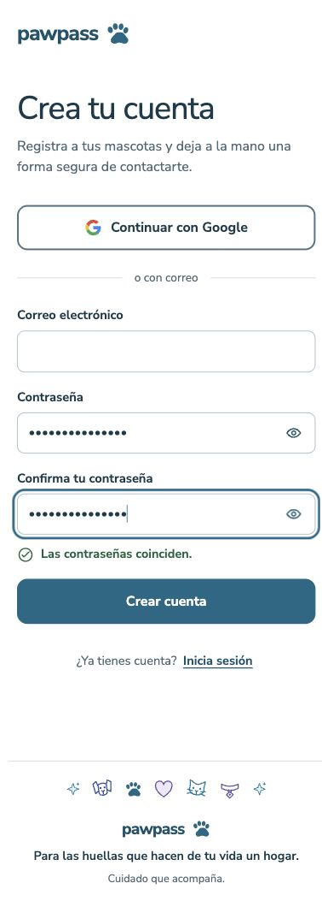

# Refactor visual · fase 3 de 3: portada y acceso

## Alcance y aceptación

La raíz `/` presenta PawPass sin cuenta y permanece accesible con sesión. Explica ficha QR/contacto, pérdida/tablón/cartel y carnet privado mediante ejemplos ficticios, sin fotografías, datos de usuarios ni contactos activos. No presenta Pawgram como disponible. La estructura y la identidad existentes se aprobaron en el chat antes de implementar; el contrato está en `.impeccable/surfaces/src-app-page-tsx.md`.

`src/features/home` reúne la composición y CSS Module de portada. `src/app/page.tsx` solo compone contenido, cabecera, identidad verificada y metadata. Reutiliza tokens, acciones, motivos SVG, menú y pie global. No importa AuthPanel ni el cliente de autenticación del navegador.

`/acceso` conserva la composición anterior de la raíz, correo/contraseña, Google, recuperación, validación y mostrar/ocultar contraseñas. `?modo=crear` abre registro directamente. Los errores del callback regresan al acceso con un mensaje controlado. La cuenta de prueba conserva su restricción a desarrollo y Supabase local; no aparece en producción.

## Navegación y privacidad

- El logo y la entrada Inicio del menú llevan a la portada pública con o sin sesión. Crear cuenta lleva a `/acceso?modo=crear`; Iniciar sesión, a `/acceso`; con identidad verificada, la portada ofrece Ir a mis mascotas.
- Sin sesión, cuenta, mascotas, editores, carnet y documentos envían a `/acceso`. Con sesión, el proxy envía `/acceso` a `/mascotas`; no redirige `/` ni interfiere con `/auth/reset-password`.
- Se movió `proxy.ts` a `src/proxy.ts`. Next 16.4.3 no estaba cargando el archivo de la raíz al usar `src/app`; el build anterior no incluía Proxy. Las comprobaciones internas de las páginas sí seguían protegiéndolas. El build final incluye Proxy y la comprobación HTTP confirma redirecciones 307 antes del render privado.
- Portada y acceso usan `private, no-store` porque pueden depender de sesión. Solo se pasa un booleano al contenido de portada, sin correo, ID u otros datos de identidad.
- Portada indexable con título, descripción y canonical propio. Acceso/privadas conservan noindex; el QR habitual conserva noindex. Tablón y búsquedas activas mantienen su política de indexación existente.
- Sitemap incluye portada y tablón incluso sin configuración de datos y añade únicamente los códigos públicos devueltos por el RPC de pérdidas. Robots anuncia el sitemap y permite leer el noindex; no se utiliza robots como control de acceso.
- No se modifican esquema, migraciones, registros, archivos de usuarios, permisos, consultas de los módulos privados ni los hallazgos de latencia/consistencia pausados. El service worker conserva su política de no almacenar HTML de navegación ni datos privados.

## Recursos de producción y coste de CSS

Next 16.4.3/webpack fusionaba el CSS de portada con el de la cabecera y lo distribuía a las demás páginas con menú. Se verificó en los manifiestos compilados. El modo `strict` no evitó esa fusión; se deshabilitó `experimental.cssChunking` para conservar la localización por ruta. `scripts/audit-route-assets.mjs` ahora incluye portada y acceso y falla ante estilos de portada en rutas ajenas.

| Ruta | Hojas enlazadas | CSS minificado | Gzip por archivo, sumado |
| --- | ---: | ---: | ---: |
| `/` | 2 | 25037 bytes | 7172 bytes |
| `/acceso` | 2 | 26379 bytes | 7660 bytes |
| `/cuenta` | 3 | 27268 bytes | 7940 bytes |
| `/perdidas` | 3 | 31892 bytes | 8853 bytes |
| `/p/[code]` | 3 | 24040 bytes | 7049 bytes |

La auditoría completa de once rutas termina sin estilos de capacidades inesperadas o ausentes. Cuenta, tablón y QR conservan los bytes CSS de la fase anterior; cambia su empaquetado. Acceso conserva sus 26379 bytes. El global sigue en 52 líneas.

**Coste aceptado y limitación:** desactivar la fusión duplica reglas compartidas entre distintos artefactos: el total emitido pasa de 77221 bytes / 24878 gzip en fase 2 a 168430 bytes / 42925 gzip, en 13 hojas. Esto puede reducir la reutilización de caché al navegar entre páginas. Se prioriza la separación efectiva de capacidades; no se presenta como mejora de latencia ni de transferencia acumulada durante una sesión.

La comprobación HTTP de scripts iniciales encuentra 8 archivos / 591049 bytes en portada y 10 / 857285 en acceso, sin compresión y sin contar caché. Verifica que `auth-heading`, identificador del AuthPanel compilado, está en el JS de acceso y ausente del JS inicial de portada. Son medidas de las dos rutas actuales, no un benchmark de red ni una comparación temporal.

## Verificación reproducible

- `npm test`: 20 archivos, 114 pruebas aprobadas. Cobertura de rutas públicas/privadas en ambos estados de sesión, política no-store, CTA según identidad sin serializar datos personales, callback incompleto/válido/destino externo y sitemap sin conexión de datos. Solo se sustituyen los clientes externos en las pruebas de handlers/identidad; no hay intercambios remotos de códigos.
- `npm run lint`, `npm run typecheck`, `npm run build` y `git diff --check`: aprobados. Las pruebas de rutas/cache y sitemap se observaron fallar antes de completar esos cambios.
- `node scripts/audit-route-assets.mjs`: inspección de CSS del build, sin sesión ni fixtures privados.
- Con `npm run start -- --hostname 127.0.0.1 --port 3000`, ejecutar `node scripts/verify-public-entry.mjs`. Admite otro origen mediante `PAWPASS_CHECK_URL`. No envía formularios ni autentica. Comprueba portada, acceso, registro, privadas, reset, callback, tablón, QR ficticio, robots, sitemap y exclusión de AuthPanel del JS inicial.
- Navegador de producción: portada y acceso en 1366 × 900 y 390 × 844; portada también en 320 px. Sin desbordamiento horizontal. Las capturas completas excluyen el scrollbar; se corrigió la escala del dispositivo del navegador antes de conservarlas.
- Menú: Escape cierra y devuelve el foco al botón. Salto al contenido: enfoca `#contenido`; el siguiente Tab continúa en Crear cuenta. Registro: contraseña diferente mantiene deshabilitado Crear cuenta; coincidencia y requisitos válidos lo habilitan. No se pulsó envío. Recuperación cambia de modo y el botón Google sigue disponible.
- Contrastes de texto usados: azul/blanco 6.17:1; secundario/blanco 5.66:1; secundario/superficie 5.38:1; rojo de texto/fondo de pérdida 7.44:1; violeta de texto/fondo de carnet 7.30:1. Foco visible y objetivos de acciones se heredan del sistema compartido.
- Detector Impeccable: solo dos tamaños fuera de escala; corregidos. Revisión visual independiente: continuidad aprobada y una corrección material de foco; veredicto final `ship` para esa corrección, comprobada en navegador y recapturas. El documenter confirmó la reutilización del sistema sin nuevos tokens.

## Límites y riesgos pendientes

No se crearon cuentas ni se enviaron correos, recuperaciones o formularios a Supabase. No se ejecutó un OAuth real, intercambio remoto de código ni una sesión completa con cuenta autenticada; el estado con sesión se comprueba mediante claims verificados simulados y render real del componente. No se probaron modificaciones privadas, archivos, exportación del cartel ni PWA instalada en dispositivo. No se certifica WCAG 2.2 AA: falta prueba formal con lector de pantalla y tecnologías de asistencia. Durante la revisión el navegador tenía un refresh token anterior inválido; la portada/acceso siguieron disponibles y no se crearon credenciales nuevas.

El sidecar `.impeccable/design.json` ya estaba desactualizado frente a DESIGN.md. No se regenera ni se canonizan desviaciones heredadas como parte de esta fase. El nuevo destino Inicio y el comportamiento del logo quedan registrados aquí.

## Capturas seguras de producción

[Portada a 320 px](capturas-fase-3/portada-320.jpg)
